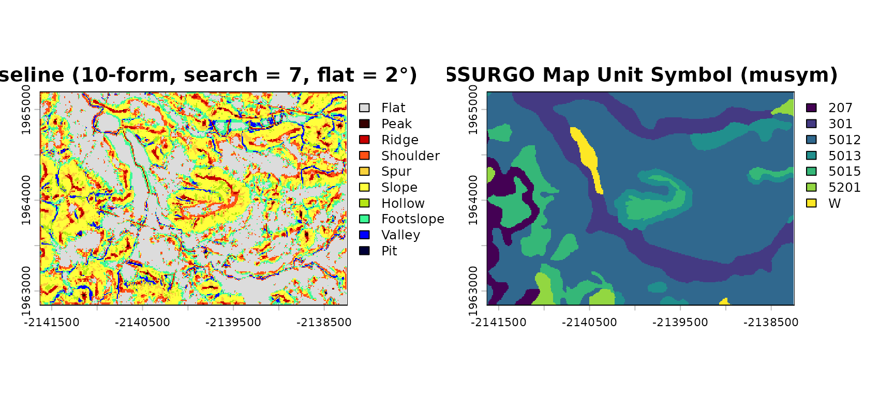
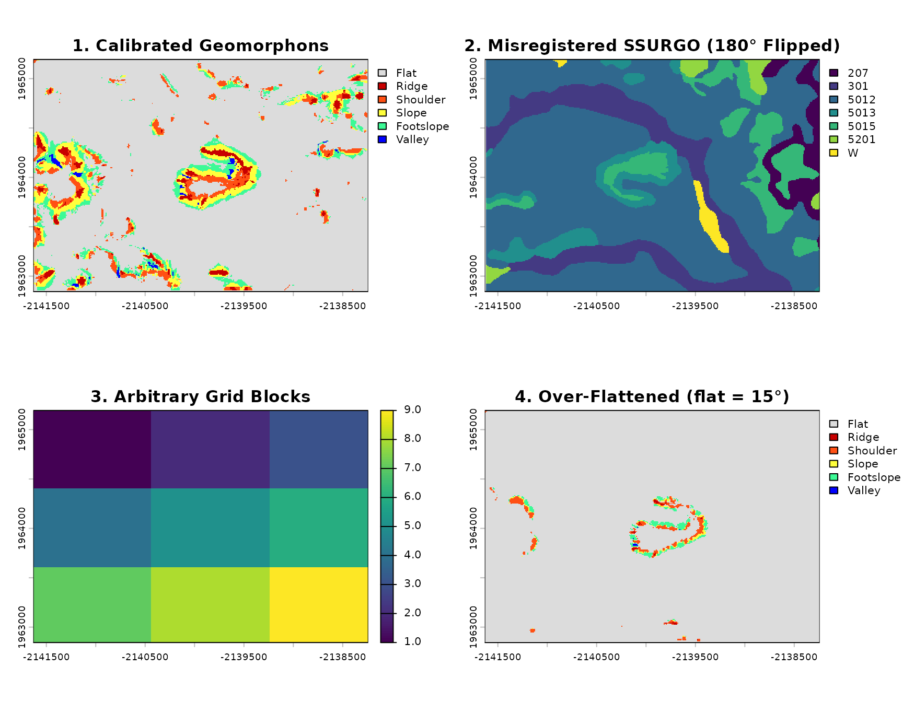

# Structural Concordance and Parameter Calibration with 'rgeomorphon'

``` r

library(rgeomorphon)
library(terra)
```

Geomorphon classifications depend on four choices: `search` radius,
`skip` distance, `flat_angle_deg`, and landform taxonomy (`forms10`,
`forms6`, `forms5`, `forms4`). When you have an external categorical map
such as a soil survey, `rgeomorphon` provides a supervised workflow to
measure agreement and tune parameters:

1.  Derive aligned categorical target layers from a raster attribute
    table with
    [`geomorphon_targets()`](https://humus.rocks/rgeomorphon/reference/geomorphon_targets.md).
2.  Score areal and boundary agreement against a reference map with
    [`geomorphon_concordance()`](https://humus.rocks/rgeomorphon/reference/geomorphon_concordance.md).
3.  Sweep parameter grids with
    [`geomorphon_sweep()`](https://humus.rocks/rgeomorphon/reference/geomorphon_sweep.md),
    evaluate every run with
    [`geomorphon_calibrate()`](https://humus.rocks/rgeomorphon/reference/geomorphon_calibrate.md),
    and select non-dominated tradeoffs with
    [`geomorphon_pareto()`](https://humus.rocks/rgeomorphon/reference/geomorphon_pareto.md).
4.  Inspect which landform classes and reference units separate or
    overlap with
    [`geomorphon_profile_dist()`](https://humus.rocks/rgeomorphon/reference/geomorphon_profile_dist.md).

This vignette runs the full workflow on the `scorpion` dataset.

------------------------------------------------------------------------

## 1. The `scorpion` Dataset

The `scorpion` dataset holds a 10 m Digital Elevation Model (aggregated
from USGS 3DEP 1 m LiDAR) and co-registered SSURGO soil map unit keys
(`mukey`) for an erosional remnant in Calaveras County, California
(`EPSG:5070`). See `data-raw/scorpion.R` for the preparation script.

Load `scorpion` and attach the SSURGO `mapunit` attribute table to the
soil raster:

``` r

data("scorpion", package = "rgeomorphon")

dem <- terra::rast(scorpion$dem)
terra::crs(dem) <- attr(scorpion, "crs")
terra::ext(dem) <- attr(scorpion, "extent")
names(dem) <- "Elevation (m)"

soil <- terra::rast(scorpion$mukey)
terra::crs(soil) <- attr(scorpion, "crs")
terra::ext(soil) <- attr(scorpion, "extent")
levels(soil) <- scorpion$mapunit

scorpion$mapunit[, c("mukey", "musym", "muname", "slopegraddcp")]
```

    ##     mukey musym                                                   muname
    ## 1 2462630     W                                                    Water
    ## 2 2600529  5013      Miltonhills-Amador complex, 15 to 45 percent slopes
    ## 3 2766836  5201            Pardee-Amador complex, 1 to 15 percent slopes
    ## 4 2766838  5012                Amador sandy loam, 2 to 15 percent slopes
    ## 5 2766850  5015        Ospital-Jennylind complex, 2 to 15 percent slopes
    ## 6 2924880   207                Pentz sandy loam, 15 to 50 percent slopes
    ## 7 2924908   301 Archerdale-Hicksville association, 0 to 2 percent slopes
    ##   slopegraddcp
    ## 1            0
    ## 2           40
    ## 3            4
    ## 4            7
    ## 5            2
    ## 6           33
    ## 7            1

------------------------------------------------------------------------

## 2. Deriving Reference Targets (`geomorphon_targets`)

A soil map unit raster often carries multiple thematic attributes in its
attribute table.
[`geomorphon_targets()`](https://humus.rocks/rgeomorphon/reference/geomorphon_targets.md)
turns selected columns into aligned categorical `SpatRaster` layers and
bins numeric columns when `breaks` are given.

Here we build two targets: `musym` (7 map unit symbols) and
`slopegraddcp` (3 slope classes: `0-2%`, `2-15%`, and `15-50%`):

``` r

targets <- geomorphon_targets(
    soil,
    vars = c("musym", "slopegraddcp"),
    breaks = list(slopegraddcp = c(-Inf, 2, 15, Inf)),
    labels = list(slopegraddcp = c("0-2%", "2-15%", "15-50%"))
)

attr(targets, "coverage")
```

    ##         target n_total n_valid n_na prop_valid n_classes
    ## 1        musym   79665   79430  235  0.9970501         7
    ## 2 slopegraddcp   79665   79430  235  0.9970501         3

The `coverage` attribute reports valid cell counts, `NA` counts, and
class counts for each derived layer.

------------------------------------------------------------------------

## 3. Structural Concordance (`geomorphon_concordance`)

[`geomorphon_concordance()`](https://humus.rocks/rgeomorphon/reference/geomorphon_concordance.md)
compares a geomorphon raster against a categorical reference raster from
three angles:

- **Areal association (`method = "nmi"`):** Normalized Mutual
  Information (`nmi`, in $`[0, 1]`$), plus its directional components
  `homogeneity` ($`I(\text{geo}; \text{cat}) / H(\text{cat})`$) and
  `completeness` ($`I(\text{geo}; \text{cat}) / H(\text{geo})`$).
- **Boundary alignment (`method = "boundary"`):** Legacy one-way metrics
  (`edge_offset`, `edge_concordance`) and symmetric metrics (`edge_f1`,
  `edge_mhd`, `edge_chamfer`). Symmetric scores detect 8-neighbor edges
  inside the shared non-`NA` domain and penalize unmatched boundaries in
  either map. Distances use projected CRS units (here meters).
- **Toroidal spatial-null contrasts (`spatial_null = TRUE`):** Up to 128
  circular translations of the reference raster produce null means
  (`mean_null_nmi`, `mean_null_edge_f1`) and observed-minus-null deltas
  (`delta_nmi`, `delta_edge_f1`).

Start with a baseline 10-form run (`search = 7`, `skip = 0`,
`flat_angle_deg = 2`):

``` r

g_base <- geomorphons(dem, search = 7, skip = 0, flat_angle_deg = 2)
conc_base <- geomorphon_concordance(g_base, targets[["musym"]], threshold_cells = 2)

data.frame(
    nmi = round(conc_base$nmi, 4),
    delta_nmi = round(conc_base$delta_nmi, 4),
    edge_concordance = round(conc_base$edge_concordance, 4),
    edge_f1 = round(conc_base$edge_f1, 4),
    delta_edge_f1 = round(conc_base$delta_edge_f1, 4),
    edge_mhd_m = round(conc_base$edge_mhd, 2),
    edge_ratio = round(conc_base$n_edges_geo / conc_base$n_edges_cat, 2)
)
```

    ##      nmi delta_nmi edge_concordance edge_f1 delta_edge_f1 edge_mhd_m edge_ratio
    ## 1 0.0769    0.0704           0.9491   0.475        0.0139      69.75       5.87

``` r

par(mfrow = c(1, 2))
terra::plot(g_base, main = "Baseline (10-form, search = 7, flat = 2°)")
terra::plot(targets[["musym"]], main = "SSURGO Map Unit Symbol (musym)")
```



``` r

par(mfrow = c(1, 1))
```

Notice the trap in the one-way metric: `edge_concordance` is near
`0.95`, yet `edge_ratio` is `5.87`. Nearly three-quarters of interior
cells are geomorphon edges, so almost any soil boundary lands within 2
cells of a landform edge by chance. Symmetric `edge_f1` (`0.475`) barely
beats its spatial-null mean (`delta_edge_f1 = +0.014`), and `nmi` is low
(`0.077`).

------------------------------------------------------------------------

## 4. Parameter Sweep and Pareto Calibration

Instead of hand-tuning one run at a time, sweep a grid of `search`,
`skip`, and `flat_angle_deg` across all four landform taxonomies in one
call to
[`geomorphon_sweep()`](https://humus.rocks/rgeomorphon/reference/geomorphon_sweep.md).
Each parameter tuple runs the ray-tracing pass once and reclassifies
into `forms10`, `forms6`, `forms5`, and `forms4`.

Then score every configuration against both targets with
[`geomorphon_calibrate()`](https://humus.rocks/rgeomorphon/reference/geomorphon_calibrate.md).
Set `spatial_null = FALSE` during the broad sweep to keep runtime short,
then run `spatial_null = TRUE` on the top Pareto candidates.

``` r

grid <- data.frame(
    search = c(5, 5, 10, 10, 10, 15, 15, 15, 25),
    skip   = c(0, 0,  0,  2,  2,  0,  2,  2,  4),
    flat_angle_deg = c(2, 5, 2, 5, 8, 2, 5, 8, 5)
)

sw <- geomorphon_sweep(
    dem,
    param_grid = grid,
    forms = c("forms10", "forms6", "forms5", "forms4")
)

cal <- geomorphon_calibrate(
    sw,
    targets = targets,
    threshold_cells = 2,
    spatial_null = FALSE
)

nrow(cal)
```

    ## [1] 72

Use
[`geomorphon_pareto()`](https://humus.rocks/rgeomorphon/reference/geomorphon_pareto.md)
to find non-dominated configurations that maximize `nmi` and `edge_f1`
while minimizing `edge_mhd`. Adding `min_edge_ratio = 0.5` and
`max_edge_ratio = 2.0` drops over-fragmented maps whose edge density is
far higher than the soil polygons:

``` r

pf_musym <- geomorphon_pareto(
    cal[cal$target == "musym", ],
    min_edge_ratio = 0.5,
    max_edge_ratio = 2.0
)

cols <- c(
    "search", "skip", "flat_angle_deg", "forms",
    "nmi", "edge_f1", "edge_mhd", "edge_ratio", "pareto_score"
)
pf_top <- pf_musym[which(pf_musym$is_pareto), cols]
pf_top <- pf_top[order(-pf_top$pareto_score), ]
pf_top[, 5:9] <- round(pf_top[, 5:9], 4)
pf_top
```

    ##    search skip flat_angle_deg   forms    nmi edge_f1 edge_mhd edge_ratio
    ## 27     10    2              5  forms6 0.2071  0.6066  55.9263     1.5553
    ## 25     10    2              5 forms10 0.2078  0.6044  55.8989     1.6192
    ## 51     15    2              5  forms6 0.2107  0.5964  55.3264     1.5753
    ## 49     15    2              5 forms10 0.2111  0.5951  55.2516     1.6504
    ## 15      5    0              5  forms4 0.1524  0.6306  41.9878     1.9998
    ##    pareto_score
    ## 27       0.8652
    ## 25       0.8629
    ## 51       0.8554
    ## 49       0.8536
    ## 15       0.0000

Check the top Pareto configuration with `spatial_null = TRUE` to verify
that its agreement exceeds random translation:

``` r

best <- pf_top[1, ]
g_best <- geomorphons(
    dem,
    search = best$search,
    skip = best$skip,
    flat_angle_deg = best$flat_angle_deg,
    forms = best$forms
)

conc_best <- geomorphon_concordance(
    g_best,
    targets[["musym"]],
    threshold_cells = 2,
    spatial_null = TRUE
)

data.frame(
    nmi = round(conc_best$nmi, 4),
    delta_nmi = round(conc_best$delta_nmi, 4),
    edge_f1 = round(conc_best$edge_f1, 4),
    delta_edge_f1 = round(conc_best$delta_edge_f1, 4),
    edge_mhd_m = round(conc_best$edge_mhd, 2),
    edge_ratio = round(conc_best$n_edges_geo / conc_best$n_edges_cat, 2)
)
```

    ##      nmi delta_nmi edge_f1 delta_edge_f1 edge_mhd_m edge_ratio
    ## 1 0.2071    0.1951  0.6066        0.2989      55.93       1.56

Compared to the baseline 10-form run, generalizing to the calibrated
`forms6` parameters (`search = 10`, `skip = 2`, `flat_angle_deg = 5`)
cuts `edge_ratio` from `5.87` to `1.56`, nearly triples `nmi` to
`0.207`, and raises `delta_edge_f1` from `+0.014` to `+0.299`.

------------------------------------------------------------------------

## 5. Diagnosing Class Separation (`geomorphon_profile_dist`)

[`geomorphon_profile_dist()`](https://humus.rocks/rgeomorphon/reference/geomorphon_profile_dist.md)
computes pairwise base-2 Jensen-Shannon divergence (JSD, bounded in
$`[0, 1]`$) between conditional profiles of a contingency table:

- `margin = 1`: compares landform classes by their soil map unit
  distributions.
- `margin = 2`: compares soil map units by their landform distributions.

``` r

ct <- conc_best$contingency_table
geo_cats <- geomorphon_categories()
rownames(ct) <- geo_cats$form[match(as.integer(rownames(ct)), geo_cats$value)]

musym_levels <- terra::cats(targets[["musym"]])[[1]]
colnames(ct) <- musym_levels$category[match(as.integer(colnames(ct)), musym_levels$id)]

# Soil map unit similarity across landforms (0 = identical, 1 = disjoint)
round(geomorphon_profile_dist(ct, margin = 2), 3)
```

    ##        207   301  5012  5013  5015  5201     W
    ## 207  0.000 0.648 0.555 0.016 0.301 0.324 0.645
    ## 301  0.648 0.000 0.012 0.532 0.175 0.123 0.002
    ## 5012 0.555 0.012 0.000 0.449 0.125 0.078 0.013
    ## 5013 0.016 0.532 0.449 0.000 0.252 0.257 0.529
    ## 5015 0.301 0.175 0.125 0.252 0.000 0.010 0.180
    ## 5201 0.324 0.123 0.078 0.257 0.010 0.000 0.126
    ## W    0.645 0.002 0.013 0.529 0.180 0.126 0.000

The JSD matrix cleanly recovers the three geomorphic groups on
`scorpion`:

- Steep remnant side slopes (`207`, `5013`) have near-zero divergence
  (`0.016`).
- Water and level alluvial plains (`W`, `301`) have near-zero divergence
  (`0.002`).
- Undulating hillslope complexes (`5015`, `5201`) cluster together
  (`0.010`).
- Steep vs. level units (`207` vs. `301`) separate sharply (`0.648`).

------------------------------------------------------------------------

## 6. Negative Controls: When Concordance Breaks Down

To see how concordance metrics behave under failure, compare the
calibrated `g_best` classification against three negative controls on
the same grid:

1.  **Misregistered soil map (`soil_flipped`):** Rotating `musym` 180
    degrees keeps identical polygon geometry and edge count but breaks
    spatial alignment.
2.  **Rectilinear grid blocks (`grid_blocks`):** Arbitrary blocks that
    ignore terrain.
3.  **Over-flattened geomorphons (`flat_angle_deg = 15°`):** Collapses
    gentle and moderate hillslopes into `flat`.

``` r

musym_r <- targets[["musym"]]
soil_flipped <- terra::flip(terra::flip(musym_r, "horizontal"), "vertical")

grid_blocks <- musym_r
rc <- terra::rowFromCell(grid_blocks, seq_len(terra::ncell(grid_blocks)))
cc <- terra::colFromCell(grid_blocks, seq_len(terra::ncell(grid_blocks)))
terra::values(grid_blocks) <- (rc %/% 80L) * 3L + (cc %/% 120L) + 1L

g_overflat <- geomorphons(
    dem,
    search = best$search,
    skip = best$skip,
    flat_angle_deg = 15,
    forms = best$forms
)

scenarios <- list(
    "1. Calibrated Reference" = geomorphon_concordance(g_best, musym_r),
    "2. Misregistered (180° Flipped)" = geomorphon_concordance(g_best, soil_flipped),
    "3. Arbitrary Grid Blocks" = geomorphon_concordance(g_best, grid_blocks),
    "4. Over-Flattened (flat = 15°)" = geomorphon_concordance(g_overflat, musym_r)
)

do.call(rbind, lapply(names(scenarios), function(nm) {
    res <- scenarios[[nm]]
    data.frame(
        Scenario = nm,
        nmi = round(res$nmi, 4),
        delta_nmi = round(res$delta_nmi, 4),
        edge_f1 = round(res$edge_f1, 4),
        delta_edge_f1 = round(res$delta_edge_f1, 4),
        edge_mhd_m = round(res$edge_mhd, 2),
        n_edges_geo = res$n_edges_geo,
        stringsAsFactors = FALSE
    )
}))
```

    ##                          Scenario    nmi delta_nmi edge_f1 delta_edge_f1
    ## 1         1. Calibrated Reference 0.2071    0.1951  0.6066        0.2989
    ## 2 2. Misregistered (180° Flipped) 0.0095   -0.0028  0.3321        0.0230
    ## 3        3. Arbitrary Grid Blocks 0.0486    0.0261  0.0738       -0.1045
    ## 4  4. Over-Flattened (flat = 15°) 0.0689    0.0609  0.2695        0.1733
    ##   edge_mhd_m n_edges_geo
    ## 1      55.93       15447
    ## 2      81.99       15447
    ## 3     254.70       15447
    ## 4     384.79        2750

``` r

par(mfrow = c(2, 2))
terra::plot(g_best, main = "1. Calibrated Geomorphons")
terra::plot(soil_flipped, main = "2. Misregistered SSURGO (180° Flipped)")
terra::plot(grid_blocks, main = "3. Arbitrary Grid Blocks")
terra::plot(g_overflat, main = "4. Over-Flattened (flat = 15°)")
```



``` r

par(mfrow = c(1, 1))
```

Each failure mode leaves a distinct signature:

- **Misregistration** collapses `nmi` and `delta_nmi` near zero and
  drops `delta_edge_f1` to noise.
- **Arbitrary grid blocks** produce negative `delta_edge_f1` (worse than
  random translation) and high `edge_mhd`.
- **Over-flattening** erases hillslope edges, driving `n_edges_geo` down
  and `edge_mhd` up into the hundreds of meters.

Read the metrics together. No single number guarantees a good thematic
match.

## References

- Jasiewicz, J., & Stepinski, T. (2013). Geomorphons — a pattern
  recognition approach to classification and mapping of landforms.
  *Geomorphology*, 182, 147–156.
  <https://doi.org/10.1016/j.geomorph.2012.11.005>
